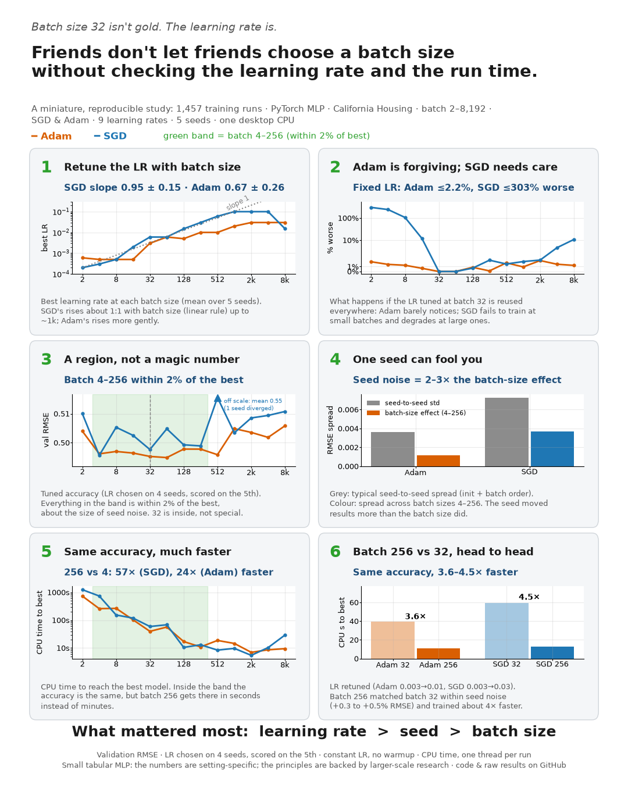

# Does "batch size ≤ 32" hold for tabular regression? A controlled PyTorch study

On 26 April 2018 Yann LeCun [wrote](https://x.com/ylecun/status/989610208497360896)
*"Friends dont let friends use minibatches larger than 32"*, linking Masters & Luschi (2018),
*Revisiting Small Batch Training for Deep Neural Networks*, whose experiments used image CNNs. This repository tests
whether that advice transfers to a small tabular problem: an MLP on California Housing,
trained on CPU, with the learning rate tuned fairly for every batch size.

> **Status:** complete. 1,457 training runs (plus 153 epoch-cap re-runs) on one desktop CPU.
> Figures are in [`figures/`](figures/), every run's raw results in [`results/`](results/).

## Results



All accuracy numbers are validation RMSE (target in $100k). For every batch size, the learning
rate is chosen on the mean over 4 seeds and scored on the 5th (leave-one-seed-out), so no number
is flattered by the tuning.

1. **Retune the learning rate when batch size changes.** SGD's best LR grows almost 1:1 with batch
   size (slope 0.95 ± 0.15 across seeds, batch ≤ 512; the linear scaling rule) up to a ceiling near
   0.1; Adam's grows more gently (0.67 ± 0.26). [Figure](figures/post_1_retune_learning_rate.png)
2. **Adam is forgiving; SGD needs care.** Reusing the batch-32 LR at every batch size costs Adam at
   most 2.2%; SGD fails to train at small batches (up to 303% worse) and loses 11% at 8,192.
   [Figure](figures/post_2_adam_forgiving.png)
3. **A region, not a magic number.** Batch sizes 4–256 are within 2% of the best for both
   optimizers (about the size of seed noise). 32 is inside, but not special: the best was 64 for
   Adam and 4 for SGD. [Figure](figures/post_3_batch_size_region.png)
4. **One seed can fool you.** The best batch size changed from seed to seed (SGD: 128, 64, 4, 4,
   32); seed noise was 2–3× the batch-size effect within 4–256.
   [Figure](figures/post_4_one_seed_can_fool_you.png)
5. **Same accuracy, much faster.** Inside that region, batch 256 reached its best model 57× faster
   than batch 4 with SGD and 24× faster with Adam (CPU time, one thread per run).
   [Figure](figures/post_5_same_accuracy_faster.png)
6. **Batch 256 vs 32.** With the LR retuned (Adam 0.003 → 0.01, SGD 0.003 → 0.03), batch 256
   matched batch 32 within seed noise (+0.3% to +0.5% RMSE) and trained 3.6–4.5× faster.
   [Figure](figures/post_6_batch_256_vs_32.png)

**What mattered most: learning rate > seed > batch size.**

**Robustness check:** re-running every capped run at batch ≥ 1024 with a 5,000-epoch cap (instead
of 1,000) left 7 of 8 large-batch results unchanged; SGD at 8,192 improved by 0.45%. The
large-batch decline is not a training-budget artifact.

## Question and pre-registered analysis

- **Question:** How does the best achievable validation RMSE depend on batch size, and how
  does that interact with learning rate, optimizer and seed (initialization + shuffle order)?
- **Factors:** batch size (powers of 2, 2 … 8192), learning rate, optimizer, seed.
- **Primary analysis:** the full tuned curve, validation RMSE at every power-of-2 batch size, each
  at its own best LR, reported as mean ± std over held-out seeds. Batch sizes are compared
  individually, never pooled into "≤ 32" and "> 32" groups.
- **Test of the "≤ 32" advice:** every batch size vs 32, paired by seed: mean difference, its
  std across seeds, and in how many seeds that batch size beats 32.
- **Leave-one-seed-out protocol:** for each seed in turn, the best LR per (optimizer, batch size)
  is chosen on the mean validation RMSE over the *other* seeds and scored on the held-out seed.
  Every batch size gets one unbiased score per seed; none is scored on data used to pick its LR.
- **LR selection rule:** lowest mean best-epoch validation RMSE; ties within 0.1% (relative) go
  to the larger LR. A configuration that never improves on its initial weights for any seed is
  ineligible.
- **Interior-optimum rule:** if a batch size's best LR is at the edge of the tested range, the
  next half-decade LR beyond it is added (`--stage extend`, repeated until nothing is added).
- **No cross-validation:** the question is how the optimum shifts, not final accuracy, so one
  frozen train/validation split is used; the test split is never touched.

## Design

| Item | Setting |
|---|---|
| Data | California Housing (20,640 rows, 8 features), `sklearn.datasets.fetch_california_housing` |
| Split | 70 / 15 / 15 train / val / test, split seed 17, indices frozen in `splits/` |
| Test set | Split off and never used in this study |
| Features | `StandardScaler` fitted on the training split only |
| Target | Raw median house value (units of $100k), no transform |
| Model | MLP 8 → 64 → ReLU → 64 → ReLU → 1, PyTorch default init, float32 |
| **Factor 1: batch size** | Powers of 2: 2, 4, 8, …, 8192 (13 values; 8192 is the largest below the 14,448 training rows) |
| **Factor 2: learning rate** | SGD: 1e-4 … 1 · Adam: 1e-5 … 1e-1 (9 half-decade points each) |
| **Factor 3: optimizer** | SGD (momentum 0.9, no Nesterov) · Adam (β = 0.9, 0.999, ε = 1e-8) |
| Regularization | None: weight decay 0, no dropout, no BatchNorm/LayerNorm, no gradient clipping |
| LR schedule | None (constant LR, so LR stays a clean factor) |
| Loss / metric | MSE loss for training; **RMSE** for all evaluation (full-set, not batch-averaged) |
| Stopping | Early stopping on validation RMSE: patience 30 epochs, cap 1000 epochs, best weights restored |
| Divergence | Stop if loss is non-finite or val RMSE > 10 × its untrained value |
| Last batch | Kept (`drop_last = false`): every training row is used every epoch |
| **Factor 4: seed** | 17, 18, 19, 20, 21 (weight init + shuffle order); the data split is fixed (split seed 17) |
| Size | 13 batch sizes × 9 LRs × 2 optimizers × 5 seeds = 1,170 runs in the main stage |

All settings live in [`configs/sweep.toml`](configs/sweep.toml).

### Controls for a fair comparison

- For a given seed, every configuration starts from **bit-identical initial weights** and the
  **same shuffle sequence**, so comparisons within a seed are paired; the 5 seeds measure how
  much results move with initialization and batch order.
- The learning rate is tuned **per batch size** on a shared grid. A single fixed LR would just
  reward the batch size that happens to suit it.
- Explicit regularization is off, so any small-batch advantage comes from gradient noise alone.
- Efficiency is reported in **optimizer steps and samples seen** (device-independent);
  wall-clock time is secondary and hardware-specific.

## Reproduce

Requires **Python 3.11 or newer** (the config is read with the built-in `tomllib`). The published
results were produced with Python 3.13 and the versions pinned in `requirements.txt`.

```bash
python -m venv .venv
# activate it, then CPU-only PyTorch:
pip install torch==2.14.0 --index-url https://download.pytorch.org/whl/cpu
pip install -r requirements.txt

python scripts/check_determinism.py             # two identical runs must match bit-for-bit
python scripts/inference_example.py              # optional: train, save, reload, predict
python run_sweep.py --stage pilot                # timing pilot (6 runs)
python run_sweep.py --stage main --workers 6     # full grid x 5 seeds, 1,170 runs, resumable
python run_sweep.py --stage extend --workers 6   # repeat until "to_run=0"
python run_sweep.py --stage refine --workers 6   # optional: x0.5 / x2 around each best LR
python run_sweep.py --stage capcheck --workers 6 # optional: capped runs at batch >= 1024, 5,000-epoch cap
marimo edit analysis.py                          # analysis (reads results/, never trains)
python scripts/make_post_figures.py              # the six summary figures -> figures/
python scripts/make_summary_card.py              # one-image summary -> figures/post_0_summary_card.png
```

- `--device auto|cpu|cuda` (default `auto`). All tensors and the model are moved with
  `.to(device)`; weights are initialized and shuffles generated on the CPU so every device
  sees the same starting point and batch order.
- `--dry-run` lists planned runs without training.
- `--workers N` runs N processes in parallel, one thread each (keeps runs deterministic).
- `--seeds 18 19` restricts a stage to some seeds (e.g. to split work across machines).
- Interrupted? Re-run the same command; finished runs (in any stage) are skipped.
- **Changing settings.** Every setting is read from `configs/sweep.toml` on each run. Adding batch
  sizes, learning rates or seeds is safe: only the new combinations run. A run's ID covers only
  optimizer, batch size, learning rate and seed, so each run also stores a `settings_hash` of
  everything else that affects it (data split, model, training settings, optimizer settings).
  If you change any of those, `run_sweep.py` refuses to reuse the old runs. Use a new folder:
  `python run_sweep.py --stage main --config configs/my_variant.toml --results-dir results_my_variant`.

## Repository layout

```
configs/sweep.toml        every design choice
src/config.py             loads and validates the config; settings fingerprint for each run
src/data.py               frozen split, train-only scaling, leakage checks
src/model.py              the MLP
src/train.py              step 1, training: one run's loop, early stopping, divergence rule
src/evaluate.py           step 2, evaluation: full-set RMSE and predictions (eval mode, no_grad)
src/selection.py          pre-registered best-LR rule and grid-edge detection
src/plan.py               which runs each stage performs
src/repro.py              device selection, determinism, environment logging
src/results.py            result file format
src/runner.py             worker-process helpers
run_sweep.py              command-line runner
analysis.py               Marimo notebook: all figures and tables
scripts/check_determinism.py
scripts/inference_example.py  step 3, inference: train -> save -> load -> predict (not part of the study)
scripts/make_post_figures.py  the six summary figures, built from analysis.py's own tables
scripts/make_summary_card.py  one-image summary of the study and its six findings
figures/                  summary figures (PNG)
splits/                   frozen split indices (created on first run)
results/<stage>/          runs.jsonl, per-epoch histories, validation predictions, env.json
REFERENCES.md             further reading on batch size
.gitattributes            keeps line endings consistent (LF) for everyone who clones the repo
```

**What is in `results/`** (one folder per stage; each run is stored once, identified by
optimizer, batch size, learning rate and seed):

| Folder | Runs | Role |
|---|---|---|
| `main/` | 1,138 | the full grid (the remaining 32 grid runs are in `seedcheck/`) |
| `extend/` | 5 | extra learning rate where a best LR sat on the grid edge (SGD, batch 2) |
| `refine/` | 242 | ×0.5 / ×2 learning rates around each best LR (used for the LR-scaling figure). `runs.jsonl` has 243 lines: one run was recorded twice when the stage was restarted; both records are identical (deterministic) and the analysis keeps one |
| `seedcheck/` | 72 | an earlier stage (seeds 18–21 at seed-17-selected LRs); its runs are ordinary grid and refine points and are reused by the analysis, not re-run |
| `capcheck/` | 153 | sensitivity check: capped runs at batch ≥ 1024 re-run with a 5,000-epoch cap; reported separately, not mixed into the main results |
| `pilot/` | 6 | timing pilot; not used in the analysis |

`main`, `extend`, `refine` and `seedcheck` together hold the 1,457 unique study runs.

## Learning PyTorch from this repo

The code is a small, complete PyTorch workflow in three steps, written to be read line by line:
**training** ([`src/train.py`](src/train.py)), **evaluation** ([`src/evaluate.py`](src/evaluate.py)) and
**inference** ([`scripts/inference_example.py`](scripts/inference_example.py)).
("Steps" are what happens to a model. "Stages" (`--stage main`, `extend`, ...) are sets of
experiments in the study; every run in every stage goes through the training and evaluation steps.)

| Concept | Where |
|---|---|
| Defining a model with `nn.Module` and `nn.Sequential` | [`src/model.py`](src/model.py) |
| Seeded weight initialization, then `.to(device)` | `build_model` in [`src/model.py`](src/model.py) |
| CPU / CUDA device selection | `resolve_device` in [`src/repro.py`](src/repro.py) |
| Reproducibility: seeds, `use_deterministic_algorithms`, thread count | `set_determinism` in [`src/repro.py`](src/repro.py) |
| Mini-batching without a `DataLoader` (`torch.randperm` + slicing) | `train_one` in [`src/train.py`](src/train.py) |
| The training step: `zero_grad` → forward → loss → `backward` → `step` | `train_one` in [`src/train.py`](src/train.py) |
| `model.train()` vs `model.eval()` + `torch.no_grad()` | `train_one` in [`src/train.py`](src/train.py); [`src/evaluate.py`](src/evaluate.py) |
| Choosing and configuring `torch.optim.SGD` / `torch.optim.Adam` | `make_optimizer` in [`src/train.py`](src/train.py) |
| Early stopping, saving and restoring `state_dict` | `train_one` in [`src/train.py`](src/train.py) |
| Detecting divergence (`torch.isfinite`) | `train_one` in [`src/train.py`](src/train.py) |
| Timing correctly on GPU (`torch.cuda.synchronize`) | `sync` in [`src/repro.py`](src/repro.py) |
| Leakage-free preprocessing (scaler fitted on training data only) | [`src/data.py`](src/data.py) |
| Running many experiments in parallel processes | [`run_sweep.py`](run_sweep.py), [`src/runner.py`](src/runner.py) |
| Checking bit-for-bit reproducibility (see [Reproducibility and determinism](#reproducibility-and-determinism)) | [`scripts/check_determinism.py`](scripts/check_determinism.py) |
| **Evaluation:** full-set RMSE in `eval()` mode under `no_grad()` (not averaged over batches) | `rmse` in [`src/evaluate.py`](src/evaluate.py) |
| **Evaluation:** predictions moved back to the CPU with `.cpu().numpy()` | `predict` in [`src/evaluate.py`](src/evaluate.py) |
| **Evaluation:** restoring the best weights and re-checking the metric from them | end of `train_one` in [`src/train.py`](src/train.py) |
| **Inference:** saving a checkpoint (weights + scaler) with `torch.save` | `save_checkpoint` in [`scripts/inference_example.py`](scripts/inference_example.py) |
| **Inference:** `torch.load(..., map_location=device, weights_only=True)` into a fresh model | `Predictor` in [`scripts/inference_example.py`](scripts/inference_example.py) |
| **Inference:** predicting from raw inputs with the same standardization as training | `Predictor.predict` in [`scripts/inference_example.py`](scripts/inference_example.py) |

### Running experiments in parallel on a CPU

`--workers N` runs N experiments at the same time, one per CPU core. Each worker is a
separate Python **process** that trains complete runs (one configuration at a time); workers
are *not* `DataLoader` workers that prepare batches. This project uses no `DataLoader`: the
data fits in memory, and each run makes its own batches with `torch.randperm` + slicing.

```python
# run_sweep.py
with ProcessPoolExecutor(max_workers=args.workers,       # N worker processes
                         initializer=init_worker,          # each loads the data once
                         initargs=(cfg, str(ROOT), args.device)) as pool:
    futures = [pool.submit(run_spec, spec, args.stage) for spec in todo]  # queue every run
    for fut in as_completed(futures):                       # collect runs as they finish
        summary, history, val_pred = fut.result()
        write_run(stage_dir, summary, history, val_pred)    # only the main process writes files
```

- **Processes, not threads.** Python's GIL stops threads from running Python code in parallel;
  separate processes run truly in parallel, have their own memory and random-number state (so
  runs can't interfere), and one crash doesn't stop the others.
- **One thread per worker.** Each run calls `torch.set_num_threads(1)` (`num_threads` in
  `configs/sweep.toml`). For a small model, extra threads add overhead, and a fixed thread count
  keeps floating-point operations in the same order, so results are bit-identical.
- **Choosing N.** Use up to the number of logical cores minus one (e.g. 11 on a 12-thread CPU).
  With hyper-threading, two workers may share a physical core, so each run is a little slower but
  total throughput is higher. On a GPU, use 1–2 workers, since they share one device.
- **Load balancing.** Runs are queued smallest batch size first (the slowest), so long jobs start
  early and fast ones fill in at the end.
- **Windows.** New processes re-import the script, so the entry point must be guarded by
  `if __name__ == "__main__":`; without it, every worker would start its own pool.
- **Resumable.** Results are written as each run finishes; re-running the same command skips
  finished runs.

## Analyses in `analysis.py`

1. Run status per optimizer and seed (converged / hit cap / diverged)
2. **Primary:** tuned RMSE vs batch size, leave-one-seed-out, mean ± std with every seed shown
3. **Each batch size vs 32, paired by seed:** mean difference, std, seeds won
4. Cost of not retuning: RMSE when the batch-size-32 LR is kept at every batch size
5. Stability of the best learning rate across seeds
6. Heatmaps over batch size × learning rate: mean and std across seeds
7. Learning-rate scaling: slope of log(best LR) vs log(batch size)
8. LR sensitivity: number of LRs within 5% of the best, per batch size
9. Steps and samples needed to reach a target RMSE (median over seeds)
10. Training speed at the best LR: CPU seconds and optimizer steps to the best epoch
11. Train–validation gap at the best epoch (implicit-regularization check)
12. Learning curves at the best LR
13. Per-seed detail table

## Reproducibility and determinism

Running the same configuration twice gives **bit-for-bit identical results**. Without that,
a difference between two settings could be run-to-run noise rather than the setting itself.

### What makes a run deterministic

| Source of randomness | How it is controlled | Where |
|---|---|---|
| Weight initialization | `torch.manual_seed(seed)` right before the model is built, on the CPU, then `.to(device)` | `build_model` in [`src/model.py`](src/model.py) |
| Batch order | a dedicated CPU `torch.Generator` seeded per run, used by `torch.randperm` | `train_one` in [`src/train.py`](src/train.py) |
| Python / NumPy randomness | `random.seed`, `np.random.seed` | `set_determinism` in [`src/repro.py`](src/repro.py) |
| Non-deterministic PyTorch kernels | `torch.use_deterministic_algorithms(True)`; on GPU also cuDNN deterministic mode and `CUBLAS_WORKSPACE_CONFIG=:4096:8` | [`src/repro.py`](src/repro.py) |
| Floating-point order from multithreading | `torch.set_num_threads(1)` per run | [`src/repro.py`](src/repro.py) |
| DataLoader worker randomness | no `DataLoader` is used | — |
| Data split | frozen indices saved in `splits/` and re-verified on every load | [`src/data.py`](src/data.py) |

For a given seed, every configuration therefore starts from the **same initial weights** and
sees batches in the **same order**, so comparisons within a seed are paired.

### The check

```bash
python scripts/check_determinism.py --optimizer adam --batch-size 256 --lr 1e-3 --epochs 20
```

[`scripts/check_determinism.py`](scripts/check_determinism.py) trains one configuration twice and
compares the run summary (excluding wall-clock time), the full per-epoch train/validation RMSE
history (NaN-aware, so diverged runs are handled), and every validation prediction. It prints
`PASS` or `FAIL` and exits with 0 or 1, so it can be used in automated tests.

### Evidence from this study

- The check passes on a normal run and on a run that diverges.
- Pilot configurations re-run inside the main sweep (a different process, under different
  parallel load) reproduced exactly, e.g. Adam at batch 32: 0.49489 at epoch 108.
- After refactoring evaluation into `src/evaluate.py`, completed study runs were re-run with the
  new code and matched their recorded results exactly (best RMSE, best epoch, full history,
  predictions).
- Every run also re-derives its validation RMSE from the restored best weights and asserts it
  matches the recorded best.

### Limits

- Bit-identical on the **same hardware, PyTorch version and thread count**.
- On other CPUs, library versions, or CPU vs GPU, expect tiny floating-point differences
  (operations run in a different order). Conclusions should hold; the last digits may not.
- The software and hardware environment of each stage is saved to `results/<stage>/env.json`.

## Limitations

- One dataset, one architecture, one train/validation split (no cross-validation; the question
  is how the optimum shifts, not final accuracy). Five seeds per configuration.
- Validation metrics only. Leave-one-seed-out removes seed-level selection bias, but LRs are
  still selected and scored on the same validation rows.
- Constant LR and default Adam β₂ at every batch size. Recent work (Marek et al., 2025) suggests
  scaling β₂ with batch size helps small-batch Adam; this may understate small batches.
- Masters & Luschi used BatchNorm CNNs and fixed epoch budgets; this is a test of whether the
  claim transfers, not a replication.
- Results say nothing about large-model / LLM training, where the useful batch size grows with
  data size and training progress (see [REFERENCES.md](REFERENCES.md)).

## License

MIT. See [LICENSE](LICENSE).
